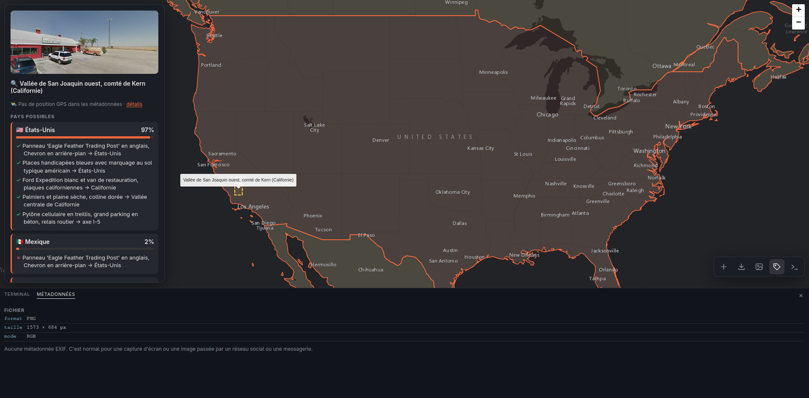
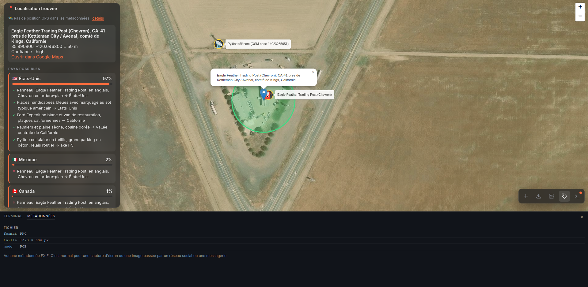

# GSW — GeoSleuth Web

Drop in a screenshot or a photo and watch its geolocation build up live on a map: candidate countries with the clues for and against each one, zones that keep narrowing down, the landmarks that identified the place, and a final point or a likely area.

The reasoning is done by [Claude Code](https://claude.com/claude-code) running headless with the [geo-sleuth](https://github.com/Oldcircle/geo-sleuth) skill (OCR, reverse image search, OSM, satellite imagery, Street View…). This app is the interface: it launches the analyses and shows their progress.

The interface is in French.

## Example

A screenshot of a roadside truck stop, with no metadata at all.

**1. The country, then the region.** GSW quickly settles on the United States, at 97%. Each clue is tied to the country it points to: English signage and a Chevron station, blue disabled parking spaces, California plates, palm trees on a dry plain. Mexico and Canada stay listed, with the clues that rule them out. The map then zooms into the western San Joaquin Valley, California.



**2. The exact spot.** The analysis keeps going down to the truck stop itself: **Eagle Feather Trading Post (Chevron)**, on CA-41 near Kettleman City, within 50 m, with high confidence. The landmarks that identified it are pinned on the map: the station, and the telecom tower found in OpenStreetMap. Clicking a landmark shows the part of the photo where it appears.



The **Métadonnées** tab at the bottom confirms there was nothing to read in the file: everything came from the image.

## Features

- Metadata is read first: if the photo has GPS coordinates, the place shows up within seconds.
- A quick pass gives a first country in about 15 s, then a deep analysis is resumed for as long as no point within 1 km has been found.
- Candidate countries with ✓/✗ clues, alternative leads, zoom steps, and landmarks with the matching crop of the photo.
- Select an area of the image (a sign, a shop front, a mountain…) to launch an analysis focused on that element.
- Built-in terminal and metadata tab.
- Save and re-import results (`.geosleuth.json`).

## Requirements

- [Node.js](https://nodejs.org) 18 or later (no npm packages)
- [Claude Code](https://claude.com/claude-code) installed and logged in (`claude` on your PATH)
- The **geo-sleuth** skill installed in `~/.claude/skills/geo-sleuth` (see [its repository](https://github.com/Oldcircle/geo-sleuth))
- [uv](https://docs.astral.sh/uv/) (for the skill's Python scripts and for reading metadata)
- Linux recommended: full process cleanup reads `/proc`. Elsewhere the app works, but only the `claude` process itself is stopped, not the scripts it launched.

## Running

```bash
node server.js
# then open http://localhost:8787
```

`PORT` sets the port, `CLAUDE_BIN` the path to the `claude` command.

Tests (with a fake `claude`, so no quota is used):

```bash
node test.js
```

## Security and privacy

- Analyses run `claude` with `--dangerously-skip-permissions`, because a headless run cannot answer permission prompts. The server only listens on `127.0.0.1`. **Do not expose it on a network.**
- Images are sent to Claude (Anthropic) and, through the skill, to reverse image search services (Baidu, Yandex) and map APIs. Don't use images you don't want to share.
- Each analysis works in a temporary `geosleuth-*` folder, deleted when it ends (or when the page is reloaded, or the server restarts) together with the matching Claude session transcript.
- Analyses use your Claude account's quota, all the more since the deep analysis can be resumed up to twice.

## Files

| File | Purpose |
|---|---|
| `server.js` | HTTP server, launching and cleaning up analyses, `@@GEO` protocol |
| `index.html` | The whole interface (Leaflet loaded from unpkg) |
| `meta.py` | Reads every metadata field of the image |
| `test.js` | End-to-end tests with a fake `claude` |
| `docs/` | Screenshots used in this README |
